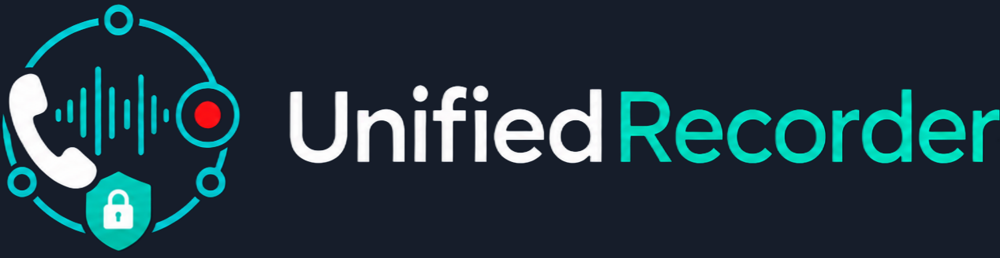

<p align="center"></p>

<h1 align="center">UnifiedRecorder Community Edition</h1>

<p align="center"><strong>Self-hosted Cisco CUCM call recording.</strong><br>
Capture, find, play, and download recordings from a focused dashboard.</p>

<p align="center">
  <a href="https://github.com/KernelNyxora/unifiedrecorder-community/releases"></a>
  <a href="LICENSE"></a>
  <a href="https://demo.unifiedrecorder.com/"></a>
</p>

<p align="center">
  <a href="#download-and-install">Download &amp; install</a> ·
  <a href="#configure-cucm-and-extensions">Configure CUCM</a> ·
  <a href="https://blog.unifiedrecorder.com/">Guides &amp; troubleshooting</a> ·
  <a href="https://demo.unifiedrecorder.com/">Pro live demo</a>
</p>

The release contains compiled Linux executables (with embedded browser
assets), an installer, and license notices. The UnifiedRecorder Go source is
not published in this repository.

## ✨ What Community includes

| Capability | Details |
| --- | --- |
| 📞 **Active recording** | Records Cisco CUCM Built-in Bridge calls. |
| 🔎 **Calls Explorer** | Search and filter by date and direction; play or download recordings. |
| 🎧 **Near/far audio** | Groups matching call legs and mixes them for playback. |
| 📱 **Extensions** | Manage enabled extension numbers and device MACs locally. |
| 🏠 **Self-hosted** | Runs on your Linux server without activation or a license-server connection. |
| 💾 **Retention** | No automatic age-based recording deletion; manage storage to fit your policy. |

There is no extension count limit in this Community build.

## 🌟 Explore Pro Edition

The [Pro Edition](https://unifiedrecorder.com/) has a separate management
dashboard for production environments. It adds live call monitoring,
analytics, user accounts and role-based access, an audit center, tags and
notes, exports, system health, managed maintenance jobs, and configurable
retention. [Try the Pro dashboard with sample data](https://demo.unifiedrecorder.com/)
without installing it. The [UnifiedRecorder blog](https://blog.unifiedrecorder.com/)
has CUCM guides and troubleshooting articles for both editions.

## Download and install

Download `unifiedrecorder-community-install.tar.gz` from
[GitHub Releases](https://github.com/KernelNyxora/unifiedrecorder-community/releases).
The current build targets Linux x86-64 and uses `apt-get` and `systemd` on
the target host. Install on a trusted server with network access to CUCM.

```bash
tar -xzf unifiedrecorder-community-install.tar.gz
cd install
sudo ACTIVE_CUCM_IP=10.10.10.30 ACTIVE_SIP_TRANSPORT=tcp \
  ./unifiedrecorder-installer --no-user-input
```

Replace the example CUCM address with your own. By default recordings use
`/var/spool/unifiedrecorder-active` on the current filesystem. To mount an
existing recording partition there, add
`--active-recording-device /dev/YOUR_PARTITION`. Check the device path before
running the installer. The installer also installs its recording engine,
FFmpeg, and MySQL Server from the operating system package repositories when
needed.

The dashboard listens on `0.0.0.0:8080` by default and has no built-in login.
Keep it on a trusted network or place an authenticated reverse proxy in front
of it. Use `--web-listen 127.0.0.1:8080` when only a local proxy should reach
the service.

## Configure CUCM and extensions

Follow the [CUCM call recording setup guide](https://blog.unifiedrecorder.com/configure-cucm-call-recording-sip-recorder)
for the SIP trunk security profile, trunk, route pattern, recording profile,
Built-in Bridge, and test call.

In CUCM, create a TCP SIP trunk to the recorder on port 5060. Route the
recording destination pattern (for example, `22888`) to that trunk, point a
recording profile at the pattern, enable Built-in Bridge on a test phone, and
assign the profile to its line. Ensure the recording profile's calling search
space can reach the route pattern. Permit TCP 5060 and the recorder's RTP UDP
range (commonly 10000–20000) to the server. Limit dashboard port 8080 to
trusted administrators.

Open the dashboard at `http://SERVER_IP:8080/` and add each extension number
and its device MAC on the **Extensions** page. Enable the entries you want to
record. The web service writes the enabled list to
`/var/lib/unifiedrecorder/extensions.json`. The recorder checks this
list before recording, and the ingest service checks it again when importing
a completed call. A call is accepted when an enabled number and device MAC
match either party.

The active ingest service reads JSON manifests and WAV files from
`/var/spool/unifiedrecorder-active`. Recordings remain until you manage or
delete them; monitor available disk space.

CUCM usually sends one WAV per call party. UnifiedRecorder groups matching
legs into one Calls Explorer entry and uses FFmpeg to mix them for playback
and download. The dashboard shows time, direction, caller, called, duration,
playback, and download.

## Verify the installation

```bash
systemctl status unifiedrecorder-web unifiedrecorder-active-ingest
curl -s http://127.0.0.1:8080/healthz
curl -s http://127.0.0.1:8080/api/extensions
sudo python3 -m json.tool /var/lib/unifiedrecorder/extensions.json
```

Make a test call from a configured CUCM phone, then check the Call Explorer.
For troubleshooting, inspect `journalctl -u unifiedrecorder-active-ingest` and
`journalctl -u unifiedrecorder-web`. If the call connects but does not record,
check the recording profile's calling search space, route pattern, Built-in
Bridge, and whether the SIP trunk reaches the recorder on port 5060.

Useful recording checks:

```bash
sudo find /var/spool/unifiedrecorder-active -maxdepth 2 -type f
```

If no WAV files appear, check the SIP trunk and RTP reachability. If a WAV
contains only one party, check that both CUCM recording legs arrived and
that FFmpeg is installed. If the extension list is empty, no calls are
accepted.

## Update an existing installation

Use the new complete installer package so the web service, ingest service,
recording helper, call routing, and environment settings change together. Extract
the new archive and rerun `unifiedrecorder-installer` with your CUCM and
storage settings. Older license files and database tables are no longer used.
The separate Pro Edition and license server are not part of this release.

## License and third-party software

Original UnifiedRecorder Community Edition code and assets are distributed
under the [MIT License](LICENSE). Keep the license notice with redistributed
copies of the binaries. See [third-party notices](THIRD-PARTY-NOTICES.txt)
and the license texts in `third_party/licenses/` for the included Go runtime
and dependencies. The MPL-licensed MySQL driver source is available from the
exact upstream versions linked in the notices.

The recording engine, FFmpeg, and MySQL Server are installed as external
operating system packages; they are not bundled in the release archive.
